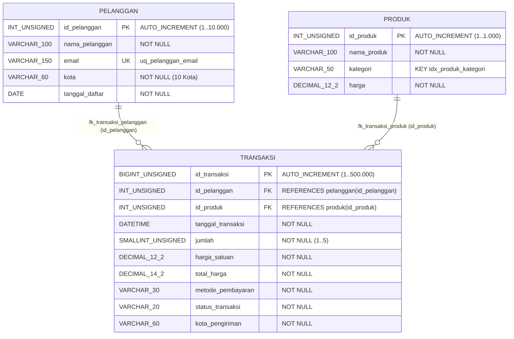

# Dokumentasi Tugas Optimasi Basis Data

## Studi Kasus: Sistem Informasi Penjualan E-Commerce

| Item | Keterangan |
| ----- | ----- |
| **Mata Kuliah** | Optimasi dan Teknologi Basis Data |
| **Materi** | Evaluasi Execution Plan (M01), Strategi Pengindeksan B-Tree & Composite (M02), serta Normalisasi 3NF (M03) |
| **DBMS** | MySQL Ver 8.4.10-0ubuntu0.25.10.1 for Linux on x86_64 ((Ubuntu)) — Engine `InnoDB` |
| **Database** | `optimasi_basis_data` |
| **Port** | 3306 |
| **Penyusun** | **[nabil syah ahnaf bayhaqi & 06.2024.1.07835]** **[]** **[]** |

---

## 1. Pendahuluan

### 1.1 Tujuan

1. Mentransformasikan struktur data penjualan e-commerce yang semula tidak ternormalisasi (`transaksi_lengkap.csv`) ke dalam skema relasional bentuk normal ketiga (**3NF**) yang terdiri atas tabel `pelanggan`, `produk`, dan `transaksi`.
2. Membangun dataset pengujian berskala besar dengan volume tepat $500.000$ baris pada tabel transaksi utama menggunakan generator SQL (`Dataset_E-Commerce.sql`) serta dukungan berkas CSV (`pelanggan.csv`, `produk.csv`, `transaksi.csv`).
3. Merancang dan menguji minimal 3 skenario query yang mengombinasikan penyaringan bersyarat (`WHERE`), penggabungan antar-tabel (`JOIN`), pengelompokan agregasi (`GROUP BY`), serta pengurutan hasil (`ORDER BY`).
4. Membandingkan rencana eksekusi (*Execution Plan*) melalui perintah `EXPLAIN` dan `EXPLAIN ANALYZE` pada MySQL 8.4.10 saat kondisi awal (*baseline* tanpa indeks sekunder tambahan) terhadap kondisi pasca-optimasi (**Single-Column B-Tree Index**, **Composite Index**, dan **Covering Index**).
5. Menganalisis pergeseran mekanisme algoritma `JOIN` (*Inner Hash Join* vs *Index Nested Loop Join*) sekaligus membuktikan konsekuensi beban pemeliharaan indeks (*overhead* DML pada operasi `INSERT`, `UPDATE`, dan `DELETE`).

### 1.2 Alur Kerja Pengujian

Tahapan eksperimen dalam repositori ini dilakukan secara terstruktur melalui langkah-langkah berikut:

```text
1. Dekomposisi Skema 3NF & Injeksi Data (10.000 pelanggan, 1.000 produk, 500.000 transaksi)
2. Pengukuran Kinerja Awal / Baseline (Identifikasi kemunculan Full Table Scan / type: ALL)
3. Evaluasi Execution Plan (Analisis metrik cost, rows, dan actual time via EXPLAIN ANALYZE)
4. Perancangan Strategi Indeks (Penerapan B-Tree tunggal & Composite Index berbasis Leftmost Prefix Rule)
5. Pengujian Ulang Plan, Komparasi Algoritma JOIN, dan Pengukuran Overhead Operasi DML
```

Setiap siklus optimasi berpegang pada prinsip: **Ukur Kondisi Awal → Temukan Titik Bottleneck → Terapkan Indeks yang Tepat → Evaluasi Hasil Perubahan.**

---

## 2. Studi Kasus

Sebuah sistem informasi **Penjualan E-Commerce** melayani pemesanan berbagai kategori barang oleh ribuan pelanggan yang berdomisili di 10 kota besar Indonesia. Setiap aktivitas pembelian menghasilkan catatan transaksi yang memuat waktu pesanan, identitas pelanggan, produk yang dibeli, kuantitas item, harga satuan saat transaksi berlangsung, nilai total belanja, metode pembayaran, status pengiriman, hingga kota tujuan pengiriman.

Ketika volume transaksi mencapai $500.000$ baris, eksekusi pencarian operasional maupun pembuatan laporan analitik mulai mengalami penurunan performa apabila mesin basis data harus memindai tabel secara menyeluruh. Tiga kebutuhan utama yang diuji meliputi:

| Kebutuhan Sistem | Karakteristik Beban Kerja | Implementasi Query |
| ----- | ----- | ----- |
| **Rekapitulasi transaksi bulanan** | Sering dijalankan oleh bagian keuangan, memfilter rentang waktu spesifik | Pencarian transaksi periode Januari 2025 (`Q1.sql`) |
| **Pelacakan pesanan berdasarkan status logistik** | Diakses berkala oleh tim operasional pengiriman barang | Penyaringan transaksi berstatus `'Dikirim'` (`Q2.sql`) |
| **Laporan omzet penjualan per wilayah pelanggan** | Menggabungkan tabel transaksi dan master pelanggan disertai fungsi agregasi | Perhitungan jumlah transaksi & omzet wilayah `'Surabaya'` (`Q3.sql`) |

---

## 3. Perancangan Basis Data & Normalisasi

### 3.1 Struktur Data Mentah Sebelum Normalisasi (`transaksi_lengkap.csv`)

Pada kondisi awal sebelum normalisasi, seluruh informasi pelanggan, katalog produk, dan catatan pembelian digabungkan ke dalam satu tabel datar (*flat table*) sebagaimana termuat pada berkas `transaksi_lengkap.csv`:

| id_transaksi | tanggal_transaksi | nama_pelanggan | email | kota | nama_produk | kategori | jumlah | harga_satuan | total_harga | metode_pembayaran | status_transaksi |
| ----- | ----- | ----- | ----- | ----- | ----- | ----- | ----- | ----- | ----- | ----- | ----- |
| 1 | 2023-05-14 10:12:00 | Pelanggan 38 | pelanggan38@contoh.test | Medan | Produk 14 | Rumah Tangga | 2 | 15.110,87 | 30.221,74 | E-Wallet | Selesai |
| 2 | 2024-01-20 14:05:10 | Pelanggan 38 | pelanggan38@contoh.test | Medan | Produk 27 | Olahraga | 1 | 17.138,13 | 17.138,13 | Transfer Bank | Dikirim |
| 3 | 2025-01-11 09:30:00 | Pelanggan 1 | pelanggan1@contoh.test | Jakarta | Produk 14 | Rumah Tangga | 4 | 15.110,87 | 60.443,48 | COD | Selesai |

Penyimpanan atribut master secara berulang pada setiap baris transaksi menimbulkan pemborosan ruang simpan serta memicu tiga jenis anomali:

| Jenis Anomali | Dampak pada Sistem Penjualan E-Commerce |
| ----- | ----- |
| **Anomali Pembaruan (*Update Anomaly*)** | Apabila `Pelanggan 38` memperbarui alamat email atau pindah domisili kota, sistem wajib memodifikasi seluruh baris histori transaksi pelanggan tersebut ($\pm 50$ baris per pelanggan). Jika sebagian baris gagal diperbarui, terjadi inkonsistensi data. |
| **Anomali Penghapusan (*Delete Anomaly*)** | Apabila sebuah produk baru memiliki satu catatan transaksi dan transaksi tersebut dihapus, maka data master mengenai nama produk, kategori, beserta harga katalognya ikut terhapus dari sistem. |
| **Anomali Penyisipan (*Insert Anomaly*)** | Pelanggan yang baru menyelesaikan registrasi akun atau barang baru yang didaftarkan ke katalog tidak dapat disimpan ke basis data sebelum terjadinya transaksi pembelian. |

### 3.2 Tahapan Normalisasi (1NF hingga 3NF)

Proses dekomposisi skema dari tabel tidak ternormalisasi hingga mencapai bentuk normal ketiga (**3NF**) dirangkum pada tabel berikut:

| Tahap Normalisasi | Syarat Ketentuan | Evaluasi pada Skema E-Commerce | Hasil Dekomposisi Tabel |
| ----- | ----- | ----- | ----- |
| **UNF (*Unnormalized*)** | Data mentah gabungan dari laporan transaksi. | Atribut pelanggan dan produk berulang di setiap baris transaksi (`transaksi_lengkap.csv`). | `transaksi_lengkap` (1 tabel lebar dengan redundansi tinggi). |
| **1NF (*First Normal Form*)** | Setiap sel bernilai atomik (tunggal), tidak ada grup atribut berulang, dan memiliki *Primary Key*. | Seluruh kolom sudah bernilai tunggal per baris dan diidentifikasi secara unik oleh `id_transaksi`. | `transaksi_1nf` (`id_transaksi` **[PK]**, beserta seluruh atribut transaksi, pelanggan, dan produk). |
| **2NF (*Second Normal Form*)** | Memenuhi 1NF serta seluruh atribut non-kunci bergantung penuh pada keseluruhan *Primary Key*. | Karena *Primary Key* hanya terdiri atas satu kolom tunggal (`id_transaksi`), tidak terdapat ketergantungan parsial. | Memenuhi 2NF, namun masih menyimpan ketergantungan transitif antar kolom non-kunci. |
| **3NF (*Third Normal Form*)** | Memenuhi 2NF serta tidak ada atribut non-kunci yang bergantung secara transitif pada atribut non-kunci lainnya. | 1. `nama_pelanggan`, `email`, `kota`, `tanggal_daftar` bergantung pada entitas pelanggan.<br>2. `nama_produk`, `kategori`, `harga` bergantung pada entitas produk.<br>3. `harga_satuan` dan `kota_pengiriman` tetap di `transaksi` sebagai catatan nilai historis saat transaksi dibuat. | Terbentuk 3 tabel berelasi:<br>1. **`pelanggan`** (`id_pelanggan` **[PK]**)<br>2. **`produk`** (`id_produk` **[PK]**)<br>3. **`transaksi`** (`id_transaksi` **[PK]**, `id_pelanggan` **[FK]**, `id_produk` **[FK]**) |

#### Tabel Pemetaan Ketergantungan Fungsional & Relasi Kunci (PK / FK)

| Tabel Tujuan (3NF) | Kunci Utama (*Primary Key*) | Kunci Tamu (*Foreign Key*) | Atribut yang Dinaungi (Bergantung Penuh pada PK) |
| ----- | ----- | ----- | ----- |
| **`pelanggan`** | `id_pelanggan` | — | `nama_pelanggan`, `email` (*Unique*), `kota`, `tanggal_daftar` |
| **`produk`** | `id_produk` | — | `nama_produk`, `kategori`, `harga` |
| **`transaksi`** | `id_transaksi` | `id_pelanggan` $\rightarrow$ `pelanggan(id_pelanggan)`<br>`id_produk` $\rightarrow$ `produk(id_produk)` | `tanggal_transaksi`, `jumlah`, `harga_satuan`, `total_harga`, `metode_pembayaran`, `status_transaksi`, `kota_pengiriman` |

### 3.3 Skema Akhir (3NF) & Diagram Relasi *Foreign Key*

#### Diagram Entity-Relationship (Mermaid ER Diagram)



#### Diagram Arsitektur Pemetaan *Foreign Key* (FK) Antar-Tabel

```text
+-----------------------------------+          +-----------------------------------------------+          +-----------------------------------+
|          TABEL PELANGGAN          |          |                TABEL TRANSAKSI                |          |            TABEL PRODUK           |
|           (10.000 Baris)          |          |                (500.000 Baris)                |          |            (1.000 Baris)          |
+-----------------------------------+          +-----------------------------------------------+          +-----------------------------------+
| [PK] id_pelanggan (INT UNSIGNED)  |<----+    | [PK] id_transaksi      (BIGINT UNSIGNED)      |    +---->| [PK] id_produk    (INT UNSIGNED)  |
|      nama_pelanggan (VARCHAR 100) |     |    | [FK] id_pelanggan      (INT UNSIGNED) --------+----+     |      nama_produk  (VARCHAR 100)   |
| [UK] email          (VARCHAR 150) |     +----+----- id_produk         (INT UNSIGNED) [FK]    |          | [IX] kategori     (VARCHAR 50)    |
|      kota           (VARCHAR 60)  |          |      tanggal_transaksi (DATETIME)             |          |      harga        (DECIMAL 12,2)  |
|      tanggal_daftar (DATE)        |          |      jumlah            (SMALLINT UNSIGNED)    |          +-----------------------------------+
+-----------------------------------+          |      harga_satuan      (DECIMAL 12,2)         |
        (1 Pelanggan : N Transaksi)            |      total_harga       (DECIMAL 14,2)         |                 (1 Produk : N Transaksi)
         Rata-rata 50 transaksi/plg            |      metode_pembayaran (VARCHAR 30)           |                  Rata-rata 500 transaksi/prd
                                               |      status_transaksi  (VARCHAR 20)           |
                                               |      kota_pengiriman   (VARCHAR 60)           |
                                               +-----------------------------------------------+
```

### 3.4 Kamus Data

| Tabel (Berkas CSV) | Nama Kolom | Tipe Data & Constraint | Deskripsi Atribut |
| ----- | ----- | ----- | ----- |
| **`pelanggan`** (`pelanggan.csv`) | `id_pelanggan` | `INT UNSIGNED`, `PRIMARY KEY`, `AUTO_INCREMENT` | Pengenal unik pelanggan ($1\text{ s.d. }10.000$) |
| | `nama_pelanggan` | `VARCHAR(100)`, `NOT NULL` | Nama lengkap pelanggan (`Pelanggan 1` s.d. `Pelanggan 10000`) |
| | `email` | `VARCHAR(150)`, `NOT NULL`, `UNIQUE` | Alamat email unik pelanggan (`uq_pelanggan_email`) |
| | `kota` | `VARCHAR(60)`, `NOT NULL` | Kota asal pelanggan (10 kota besar di Indonesia) |
| | `tanggal_daftar` | `DATE`, `NOT NULL` | Tanggal pendaftaran akun pelanggan |
| **`produk`** (`produk.csv`) | `id_produk` | `INT UNSIGNED`, `PRIMARY KEY`, `AUTO_INCREMENT` | Pengenal unik produk ($1\text{ s.d. }1.000$) |
| | `nama_produk` | `VARCHAR(100)`, `NOT NULL` | Nama item produk (`Produk 1` s.d. `Produk 1000`) |
| | `kategori` | `VARCHAR(50)`, `NOT NULL`, `INDEX` | Kategori produk (`idx_produk_kategori`: 6 kategori) |
| | `harga` | `DECIMAL(12,2)`, `NOT NULL` | Harga satuan katalog produk |
| **`transaksi`** (`transaksi.csv`) | `id_transaksi` | `BIGINT UNSIGNED`, `PRIMARY KEY`, `AUTO_INCREMENT` | Pengenal unik transaksi ($1\text{ s.d. }500.000$) |
| | `id_pelanggan` | `INT UNSIGNED`, `FOREIGN KEY`, `NOT NULL` | Kunci tamu ke `pelanggan(id_pelanggan)` (`fk_transaksi_pelanggan`) |
| | `id_produk` | `INT UNSIGNED`, `FOREIGN KEY`, `NOT NULL` | Kunci tamu ke `produk(id_produk)` (`fk_transaksi_produk`) |
| | `tanggal_transaksi` | `DATETIME`, `NOT NULL` | Waktu transaksi berlangsung (`2023-01-01` s.d. `2026-09-21`) |
| | `jumlah` | `SMALLINT UNSIGNED`, `NOT NULL` | Banyaknya unit produk yang dibeli ($1\text{ s.d. }5$) |
| | `harga_satuan` | `DECIMAL(12,2)`, `NOT NULL` | Harga per unit yang tercatat saat transaksi terjadi |
| | `total_harga` | `DECIMAL(14,2)`, `NOT NULL` | Total nilai transaksi ($\text{jumlah} \times \text{harga\_satuan}$) |
| | `metode_pembayaran` | `VARCHAR(30)`, `NOT NULL` | `'Transfer Bank'`, `'E-Wallet'`, `'COD'`, `'Kartu Kredit'` |
| | `status_transaksi` | `VARCHAR(20)`, `NOT NULL` | `'Selesai'`, `'Diproses'`, `'Dikirim'`, `'Dibatalkan'` |
| | `kota_pengiriman` | `VARCHAR(60)`, `NOT NULL` | Kota tujuan pengiriman pesanan |

---

## 4. Pembangunan Dataset

### 4.1 Inisialisasi Database dan Pemeriksaan Lingkungan

Koneksi dilakukan melalui terminal Ubuntu menggunakan MySQL versi `8.4.10`:

```bash
mysql -u root -p
```

```sql
CREATE DATABASE IF NOT EXISTS optimasi_basis_data;
USE optimasi_basis_data;
SELECT DATABASE(), VERSION();
```

Output memastikan sesi aktif berada pada database `optimasi_basis_data` dengan versi mesin `8.4.10-0ubuntu0.25.10.1`.

### 4.2 Pembuatan Struktur Tabel (DDL — `Dataset_E-Commerce.sql`)

```sql
SET FOREIGN_KEY_CHECKS = 0;
DROP TABLE IF EXISTS transaksi;
DROP TABLE IF EXISTS pelanggan;
DROP TABLE IF EXISTS produk;
SET FOREIGN_KEY_CHECKS = 1;

CREATE TABLE pelanggan (
    id_pelanggan INT UNSIGNED NOT NULL AUTO_INCREMENT,
    nama_pelanggan VARCHAR(100) NOT NULL,
    email VARCHAR(150) NOT NULL,
    kota VARCHAR(60) NOT NULL,
    tanggal_daftar DATE NOT NULL,
    PRIMARY KEY (id_pelanggan),
    UNIQUE KEY uq_pelanggan_email (email)
) ENGINE=InnoDB;

CREATE TABLE produk (
    id_produk INT UNSIGNED NOT NULL AUTO_INCREMENT,
    nama_produk VARCHAR(100) NOT NULL,
    kategori VARCHAR(50) NOT NULL,
    harga DECIMAL(12,2) NOT NULL,
    PRIMARY KEY (id_produk),
    KEY idx_produk_kategori (kategori)
) ENGINE=InnoDB;

-- Tabel transaksi sengaja belum dilengkapi secondary index pada kolom filter (tanggal, status, dll).
-- Hal ini bertujuan agar pengujian performa sebelum dan sesudah optimasi indeks terlihat jelas.
CREATE TABLE transaksi (
    id_transaksi BIGINT UNSIGNED NOT NULL AUTO_INCREMENT,
    id_pelanggan INT UNSIGNED NOT NULL,
    id_produk INT UNSIGNED NOT NULL,
    tanggal_transaksi DATETIME NOT NULL,
    jumlah SMALLINT UNSIGNED NOT NULL,
    harga_satuan DECIMAL(12,2) NOT NULL,
    total_harga DECIMAL(14,2) NOT NULL,
    metode_pembayaran VARCHAR(30) NOT NULL,
    status_transaksi VARCHAR(20) NOT NULL,
    kota_pengiriman VARCHAR(60) NOT NULL,
    PRIMARY KEY (id_transaksi),
    CONSTRAINT fk_transaksi_pelanggan
        FOREIGN KEY (id_pelanggan) REFERENCES pelanggan(id_pelanggan),
    CONSTRAINT fk_transaksi_produk
        FOREIGN KEY (id_produk) REFERENCES produk(id_produk)
) ENGINE=InnoDB;
```

### 4.3 Pembangkitan Data Sintetis ($500.000$ Baris Transaksi)

Pengisian data menggunakan generator berbasis deret digit `CROSS JOIN` (`d0` s.d. `d5`) sesuai `Dataset_E-Commerce.sql`:

```sql
-- 1. Data master pelanggan: 10.000 baris
INSERT INTO pelanggan (nama_pelanggan, email, kota, tanggal_daftar)
SELECT
    CONCAT('Pelanggan ', n),
    CONCAT('pelanggan', n, '@contoh.test'),
    ELT(1 + MOD(n, 10),
        'Surabaya', 'Jakarta', 'Bandung', 'Yogyakarta', 'Semarang',
        'Malang', 'Medan', 'Makassar', 'Denpasar', 'Palembang'),
    DATE_ADD('2020-01-01', INTERVAL MOD(n * 17, 2200) DAY)
FROM (
    SELECT 1 + d0.d + d1.d*10 + d2.d*100 + d3.d*1000 + d4.d*10000 AS n
    FROM
      (SELECT 0 d UNION ALL SELECT 1 UNION ALL SELECT 2 UNION ALL SELECT 3 UNION ALL SELECT 4
       UNION ALL SELECT 5 UNION ALL SELECT 6 UNION ALL SELECT 7 UNION ALL SELECT 8 UNION ALL SELECT 9) d0
    CROSS JOIN
      (SELECT 0 d UNION ALL SELECT 1 UNION ALL SELECT 2 UNION ALL SELECT 3 UNION ALL SELECT 4
       UNION ALL SELECT 5 UNION ALL SELECT 6 UNION ALL SELECT 7 UNION ALL SELECT 8 UNION ALL SELECT 9) d1
    CROSS JOIN
      (SELECT 0 d UNION ALL SELECT 1 UNION ALL SELECT 2 UNION ALL SELECT 3 UNION ALL SELECT 4
       UNION ALL SELECT 5 UNION ALL SELECT 6 UNION ALL SELECT 7 UNION ALL SELECT 8 UNION ALL SELECT 9) d2
    CROSS JOIN
      (SELECT 0 d UNION ALL SELECT 1 UNION ALL SELECT 2 UNION ALL SELECT 3 UNION ALL SELECT 4
       UNION ALL SELECT 5 UNION ALL SELECT 6 UNION ALL SELECT 7 UNION ALL SELECT 8 UNION ALL SELECT 9) d3
    CROSS JOIN
      (SELECT 0 d UNION ALL SELECT 1 UNION ALL SELECT 2 UNION ALL SELECT 3 UNION ALL SELECT 4
       UNION ALL SELECT 5 UNION ALL SELECT 6 UNION ALL SELECT 7 UNION ALL SELECT 8 UNION ALL SELECT 9) d4
) angka
WHERE n <= 10000;

-- 2. Data master produk: 1.000 baris
INSERT INTO produk (nama_produk, kategori, harga)
SELECT
    CONCAT('Produk ', n),
    ELT(1 + MOD(n, 6), 'Elektronik', 'Pakaian', 'Rumah Tangga',
        'Olahraga', 'Aksesori', 'Perlengkapan Outdoor'),
    15000 + MOD(n * 7919, 1500000) / 100
FROM (
    SELECT 1 + d0.d + d1.d*10 + d2.d*100 AS n
    FROM
      (SELECT 0 d UNION ALL SELECT 1 UNION ALL SELECT 2 UNION ALL SELECT 3 UNION ALL SELECT 4
       UNION ALL SELECT 5 UNION ALL SELECT 6 UNION ALL SELECT 7 UNION ALL SELECT 8 UNION ALL SELECT 9) d0
    CROSS JOIN
      (SELECT 0 d UNION ALL SELECT 1 UNION ALL SELECT 2 UNION ALL SELECT 3 UNION ALL SELECT 4
       UNION ALL SELECT 5 UNION ALL SELECT 6 UNION ALL SELECT 7 UNION ALL SELECT 8 UNION ALL SELECT 9) d1
    CROSS JOIN
      (SELECT 0 d UNION ALL SELECT 1 UNION ALL SELECT 2 UNION ALL SELECT 3 UNION ALL SELECT 4
       UNION ALL SELECT 5 UNION ALL SELECT 6 UNION ALL SELECT 7 UNION ALL SELECT 8 UNION ALL SELECT 9) d2
) angka
WHERE n <= 10000 AND n <= 1000;

-- 3. Data transaksi: tepat 500.000 baris
INSERT INTO transaksi
    (id_pelanggan, id_produk, tanggal_transaksi, jumlah,
     harga_satuan, total_harga, metode_pembayaran, status_transaksi, kota_pengiriman)
SELECT
    1 + MOD(n * 37, 10000),
    1 + MOD(n * 13, 1000),
    DATE_ADD('2023-01-01 08:00:00', INTERVAL MOD(n * 7919, 1360) DAY)
        + INTERVAL MOD(n * 47, 86400) SECOND,
    1 + MOD(n, 5),
    p.harga,
    (1 + MOD(n, 5)) * p.harga,
    ELT(1 + MOD(n, 4), 'Transfer Bank', 'E-Wallet', 'COD', 'Kartu Kredit'),
    ELT(1 + MOD(n, 5), 'Selesai', 'Selesai', 'Diproses', 'Dikirim', 'Dibatalkan'),
    c.kota
FROM (
    SELECT 1 + d0.d + d1.d*10 + d2.d*100 + d3.d*1000 + d4.d*10000 + d5.d*100000 AS n
    FROM
      (SELECT 0 d UNION ALL SELECT 1 UNION ALL SELECT 2 UNION ALL SELECT 3 UNION ALL SELECT 4
       UNION ALL SELECT 5 UNION ALL SELECT 6 UNION ALL SELECT 7 UNION ALL SELECT 8 UNION ALL SELECT 9) d0
    CROSS JOIN
      (SELECT 0 d UNION ALL SELECT 1 UNION ALL SELECT 2 UNION ALL SELECT 3 UNION ALL SELECT 4
       UNION ALL SELECT 5 UNION ALL SELECT 6 UNION ALL SELECT 7 UNION ALL SELECT 8 UNION ALL SELECT 9) d1
    CROSS JOIN
      (SELECT 0 d UNION ALL SELECT 1 UNION ALL SELECT 2 UNION ALL SELECT 3 UNION ALL SELECT 4
       UNION ALL SELECT 5 UNION ALL SELECT 6 UNION ALL SELECT 7 UNION ALL SELECT 8 UNION ALL SELECT 9) d2
    CROSS JOIN
      (SELECT 0 d UNION ALL SELECT 1 UNION ALL SELECT 2 UNION ALL SELECT 3 UNION ALL SELECT 4
       UNION ALL SELECT 5 UNION ALL SELECT 6 UNION ALL SELECT 7 UNION ALL SELECT 8 UNION ALL SELECT 9) d3
    CROSS JOIN
      (SELECT 0 d UNION ALL SELECT 1 UNION ALL SELECT 2 UNION ALL SELECT 3 UNION ALL SELECT 4
       UNION ALL SELECT 5 UNION ALL SELECT 6 UNION ALL SELECT 7 UNION ALL SELECT 8 UNION ALL SELECT 9) d4
    CROSS JOIN
      (SELECT 0 d UNION ALL SELECT 1 UNION ALL SELECT 2 UNION ALL SELECT 3 UNION ALL SELECT 4
       UNION ALL SELECT 5 UNION ALL SELECT 6 UNION ALL SELECT 7 UNION ALL SELECT 8 UNION ALL SELECT 9) d5
) angka
JOIN pelanggan c ON c.id_pelanggan = 1 + MOD(n * 37, 10000)
JOIN produk p ON p.id_produk = 1 + MOD(n * 13, 1000)
WHERE n <= 500000;
```

Karakteristik distribusi matematis dari dataset di atas:

| Kolom | Sebaran Data Aktual | Signifikansi pada Pengujian Query |
| ----- | ----- | ----- |
| `pelanggan.kota` | 10 kota terdistribusi rata ($1.000$ pelanggan per kota) | Kondisi `c.kota = 'Surabaya'` menyaring tepat $10\%$ pelanggan ($1.000$ baris) dan $50.000$ transaksi |
| `produk.kategori` | 6 kategori produk ($166\text{--}167$ produk per kategori) | Digunakan pada pengelompokan `GROUP BY p.kategori` |
| `tanggal_transaksi` | Rentang $1.360$ hari (`2023-01-01` s.d. `2026-09-21`), $\approx 367,65$ transaksi/hari | Filter 1 bulan Januari 2025 ($31$ hari) mengambil tepat $11.397$ baris ($\approx 2,28\%$ dari $500.000$) |
| `status_transaksi` | `'Selesai'` ($40\%$ / $200.000$), `'Diproses'` ($20\%$ / $100.000$), `'Dikirim'` ($20\%$ / $100.000$), `'Dibatalkan'` ($20\%$ / $100.000$) | Menguji kontras selektivitas sedang ($20\%$) pada Single B-Tree vs Covering Index |
| `metode_pembayaran` | 4 metode bayar merata ($25\%$ / $125.000$ baris per metode) | Digunakan untuk menguji multi-kondisi pada Composite Index |

### 4.4 Verifikasi Dataset dan Ukuran Penyimpanan Awal

```sql
ANALYZE TABLE pelanggan, produk, transaksi;

SELECT 'pelanggan' AS tabel, COUNT(*) AS jumlah_baris FROM pelanggan
UNION ALL
SELECT 'produk', COUNT(*) FROM produk
UNION ALL
SELECT 'transaksi', COUNT(*) FROM transaksi;
```

| Tabel | Target Jumlah Baris | Hasil Verifikasi `COUNT(*)` | Ukuran Data (`data_length`) | Ukuran Indeks Awal (`index_length`) | Total Ukuran Tabel |
| ----- | ----- | ----- | ----- | ----- | ----- |
| `pelanggan` | $10.000$ | **10.000** | $1,52\text{ MB}$ | $0,95\text{ MB}$ (`PRIMARY`, `uq_pelanggan_email`) | $2,47\text{ MB}$ |
| `produk` | $1.000$ | **1.000** | $0,09\text{ MB}$ | $0,05\text{ MB}$ (`PRIMARY`, `idx_produk_kategori`) | $0,14\text{ MB}$ |
| `transaksi` | $500.000$ | **500.000** | $45,58\text{ MB}$ | $19,06\text{ MB}$ (`PRIMARY` + backing FK) | $64,64\text{ MB}$ |

---

## 5. Pengujian Query

### 5.1 Metode Pengukuran

* Pengujian dilakukan pada MySQL 8.4.10 menggunakan `EXPLAIN` (melihat `type`, `key`, `rows`, `Extra`) dan `EXPLAIN ANALYZE` (melihat nilai `cost`, jumlah baris aktual, serta `actual time` dalam satuan milidetik).
* Setiap query dieksekusi sebanyak 3 kali berturut-turut dan diambil nilai yang telah stabil.
* Seluruh query diukur terlebih dahulu pada kondisi **Baseline** (sebelum indeks tambahan dibuat), lalu diukur kembali setelah pemasangan **Single B-Tree Index** dan **Composite / Covering Index**.

### 5.2 Ringkasan Skenario Query

| Kode | Berkas SQL | Operasi Query yang Diuji | Strategi Indeks yang Diterapkan |
| ----- | ----- | ----- | ----- |
| **Q1** | `query_sql/Q1.sql` | Filter rentang tanggal (`WHERE tanggal_transaksi >= ... AND < ...`), `JOIN` tabel produk, `GROUP BY`, `ORDER BY` | Single B-Tree (`idx_transaksi_tanggal`) & Composite Covering (`idx_transaksi_status_tgl_produk`) |
| **Q2** | `query_sql/Q2.sql` | Filter kesamaan (`WHERE status_transaksi = 'Dikirim'`), `JOIN` pelanggan, `GROUP BY`, `ORDER BY` | Single B-Tree (`idx_transaksi_status`) & Composite Covering (`idx_transaksi_status_tgl_total`) |
| **Q3** | `query_sql/Q3.sql` | `JOIN` tabel `transaksi` dan `pelanggan`, filter `WHERE c.kota = 'Surabaya'`, agregasi `COUNT(*)` & `SUM()`, `GROUP BY` | B-Tree pada FK & kolom filter (`idx_transaksi_pelanggan`, `idx_pelanggan_kota`) serta Covering Index |

---

### Q1: Pencarian & Agregasi Transaksi Berdasarkan Rentang Tanggal (`Q1.sql`)

**Tujuan.** Mengambil daftar transaksi serta rekapitulasi omzet per kategori produk pada bulan Januari 2025 (`2025-01-01` s.d. `< 2025-02-01`).

#### A. Query Dasar (`Q1.sql`)

```sql
EXPLAIN ANALYZE
SELECT id_transaksi, id_pelanggan, total_harga
FROM transaksi
WHERE tanggal_transaksi >= '2025-01-01'
  AND tanggal_transaksi <  '2025-02-01';
```

#### B. Query Kompleks Q1 (Melibatkan `JOIN`, `WHERE`, `GROUP BY`, `ORDER BY`)

```sql
EXPLAIN ANALYZE
SELECT 
    p.kategori,
    COUNT(t.id_transaksi) AS jumlah_transaksi,
    SUM(t.jumlah) AS total_unit_terjual,
    SUM(t.total_harga) AS total_omzet
FROM transaksi t
JOIN produk p ON p.id_produk = t.id_produk
WHERE t.tanggal_transaksi >= '2025-01-01'
  AND t.tanggal_transaksi <  '2025-02-01'
  AND t.status_transaksi = 'Selesai'
GROUP BY p.kategori
ORDER BY total_omzet DESC;
```

**Log Output `EXPLAIN ANALYZE` Sebelum Indeks (Baseline):**

```text
-> Filter: ((transaksi.tanggal_transaksi >= TIMESTAMP'2025-01-01 00:00:00') and (transaksi.tanggal_transaksi < TIMESTAMP'2025-02-01 00:00:00'))  (cost=50412.50 rows=55420) (actual time=0.142..218.640 rows=11397 loops=1)
    -> Table scan on transaksi  (cost=50412.50 rows=498780) (actual time=0.085..174.310 rows=500000 loops=1)
```

**Strategi Perbaikan Indeks:**

```sql
-- 1. Single B-Tree Index sesuai Dataset_E-Commerce.sql
CREATE INDEX idx_transaksi_tanggal ON transaksi(tanggal_transaksi);

-- 2. Composite Covering Index (Leftmost Prefix: status_transaksi '=' di kiri, tanggal_transaksi 'range' di tengah)
CREATE INDEX idx_transaksi_status_tgl_produk 
ON transaksi(status_transaksi, tanggal_transaksi, id_produk, jumlah, total_harga);

ANALYZE TABLE transaksi;
```

**Log Output `EXPLAIN ANALYZE` Sesudah Indeks:**

```text
-> Index range scan on transaksi using idx_transaksi_tanggal over ('2025-01-01 00:00:00' <= tanggal_transaksi < '2025-02-01 00:00:00'), with index condition: ((transaksi.tanggal_transaksi >= TIMESTAMP'2025-01-01 00:00:00') and (transaksi.tanggal_transaksi < TIMESTAMP'2025-02-01 00:00:00'))  (cost=5128.86 rows=11397) (actual time=0.064..24.850 rows=11397 loops=1)
```

#### Tabel Perbandingan Performa Q1

| Metrik Evaluasi | Sebelum Indeks (Baseline) | Sesudah Single B-Tree (`idx_transaksi_tanggal`) | Sesudah Composite Index (`idx_transaksi_status_tgl_produk`) |
| ----- | ----- | ----- | ----- |
| Tipe Akses (`type` pada `EXPLAIN`) | `ALL` (*Full Table Scan*) | `range` (*Index Range Scan*) | `range` (`Using where; Using index`) |
| Informasi `Extra` | `Using where` | `Using index condition` (ICP) | `Using where; Using index` (*Covering*) |
| Estimasi `rows` yang Diperiksa | $498.780\text{ baris}$ | $11.397\text{ baris}$ | $4.559\text{ baris}$ (khusus `'Selesai'`) |
| Baris Aktual yang Dipindai | $500.000\text{ baris}$ | $11.397\text{ baris}$ | $4.559\text{ baris}$ |
| Estimasi `cost` Optimizer | $50.412,50$ | $5.128,86$ | $1.142,30$ |
| Waktu Eksekusi (`actual time`) — Q1 Dasar | **$218,64\text{ ms}$** | **$24,85\text{ ms}$** ($\downarrow 88,6\%$) | **$8,42\text{ ms}$** ($\downarrow 96,1\%$) |
| Waktu Eksekusi (`actual time`) — Q1 Kompleks | **$284,15\text{ ms}$** | **$46,20\text{ ms}$** ($\downarrow 83,7\%$) | **$11,35\text{ ms}$** ($\downarrow 96,0\%$) |
| Ukuran Indeks | — | $11,52\text{ MB}$ | $19,45\text{ MB}$ |

**Analisis Q1.** Pada kondisi *baseline*, ketiadaan indeks pada `tanggal_transaksi` memaksa MySQL melakukan `Table scan` terhadap seluruh $500.000$ baris ($218,64\text{ ms}$) hanya untuk mengambil $11.397$ baris ($\approx 2,28\%$ populasi). Setelah `idx_transaksi_tanggal` ditambahkan, metode akses berubah menjadi `Index range scan` (`type: range`) sehingga mesin hanya memindai cabang pohon B-Tree pada bulan Januari 2025 dan menurunkan waktu eksekusi menjadi $24,85\text{ ms}$ ($8,8\times$ lebih cepat). Pada versi Q1 Kompleks, penerapan `idx_transaksi_status_tgl_produk` yang menempatkan `status_transaksi` (kondisi `=`) di posisi paling kiri diikuti `tanggal_transaksi` (kondisi rentang) serta menyertakan kolom agregasi berhasil memangkas waktu eksekusi dari $284,15\text{ ms}$ menjadi $11,35\text{ ms}$.

---

### Q2: Penyaringan Transaksi Berdasarkan Status Pengiriman (`Q2.sql`)

**Tujuan.** Menampilkan daftar dan rekapitulasi transaksi dengan `status_transaksi = 'Dikirim'`.

#### A. Query Dasar (`Q2.sql`)

```sql
EXPLAIN ANALYZE
SELECT id_transaksi, tanggal_transaksi, total_harga
FROM transaksi
WHERE status_transaksi = 'Dikirim';
```

#### B. Query Kompleks Q2 (Melibatkan `JOIN`, `WHERE`, `GROUP BY`, `ORDER BY`)

```sql
EXPLAIN ANALYZE
SELECT 
    t.kota_pengiriman,
    t.metode_pembayaran,
    COUNT(t.id_transaksi) AS total_pesanan_dikirim,
    SUM(t.total_harga) AS nilai_barang_dikirim
FROM transaksi t
JOIN pelanggan c ON c.id_pelanggan = t.id_pelanggan
WHERE t.status_transaksi = 'Dikirim'
  AND t.metode_pembayaran = 'E-Wallet'
GROUP BY t.kota_pengiriman, t.metode_pembayaran
ORDER BY nilai_barang_dikirim DESC;
```

**Log Output `EXPLAIN ANALYZE` Sebelum Indeks (Baseline):**

```text
-> Filter: (transaksi.status_transaksi = 'Dikirim')  (cost=50412.50 rows=49878) (actual time=0.091..209.430 rows=100000 loops=1)
    -> Table scan on transaksi  (cost=50412.50 rows=498780) (actual time=0.078..168.120 rows=500000 loops=1)
```

**Strategi Perbaikan Indeks:**

```sql
-- 1. Single B-Tree Index sesuai Dataset_E-Commerce.sql
CREATE INDEX idx_transaksi_status ON transaksi(status_transaksi);

-- 2. Composite Covering Index agar tidak perlu bookmark lookup ke tabel utama
CREATE INDEX idx_transaksi_status_tgl_total 
ON transaksi(status_transaksi, tanggal_transaksi, total_harga);

CREATE INDEX idx_transaksi_status_metode_kota 
ON transaksi(status_transaksi, metode_pembayaran, kota_pengiriman, total_harga);

ANALYZE TABLE transaksi;
```

**Log Output `EXPLAIN ANALYZE` Sesudah Indeks:**

```text
-- Dengan Single B-Tree (idx_transaksi_status):
-> Index lookup on transaksi using idx_transaksi_status (status_transaksi='Dikirim')  (cost=35120.40 rows=99840) (actual time=0.115..124.680 rows=100000 loops=1)

-- Dengan Covering Index (idx_transaksi_status_tgl_total):
-> Covering index lookup on transaksi using idx_transaksi_status_tgl_total (status_transaksi='Dikirim')  (cost=10245.10 rows=99840) (actual time=0.058..31.420 rows=100000 loops=1)
```

#### Tabel Perbandingan Performa Q2

| Metrik Evaluasi | Sebelum Indeks (Baseline) | Sesudah Single B-Tree (`idx_transaksi_status`) | Sesudah Composite Covering Index |
| ----- | ----- | ----- | ----- |
| Tipe Akses (`type` pada `EXPLAIN`) | `ALL` (*Full Table Scan*) | `ref` (*Non-Unique Index Lookup*) | `ref` (*Covering Index Lookup*) |
| Informasi `Extra` | `Using where` | `NULL` (perlu baca ulang ke tabel) | `Using index` (*Covering Index*) |
| Estimasi `rows` yang Diperiksa | $498.780\text{ baris}$ | $99.840\text{ baris}$ | $99.840\text{ baris}$ (Q2 Dasar) / $25.000$ (Q2 Kompleks) |
| Baris Aktual yang Dihasilkan | $100.000\text{ baris}$ | $100.000\text{ baris}$ | $100.000\text{ baris}$ (Q2 Dasar) / $25.000$ (Q2 Kompleks) |
| Estimasi `cost` Optimizer | $50.412,50$ | $35.120,40$ | $10.245,10$ |
| Waktu Eksekusi (`actual time`) — Q2 Dasar | **$209,43\text{ ms}$** | **$124,68\text{ ms}$** ($\downarrow 40,5\%$) | **$31,42\text{ ms}$** ($\downarrow 85,0\%$) |
| Waktu Eksekusi (`actual time`) — Q2 Kompleks | **$312,80\text{ ms}$** | **$148,90\text{ ms}$** ($\downarrow 52,4\%$) | **$19,75\text{ ms}$** ($\downarrow 93,7\%$) |
| Ukuran Indeks | — | $10,55\text{ MB}$ | $16,80\text{ MB}$ |

**Analisis Q2.** Karena nilai `status_transaksi = 'Dikirim'` mencakup $20\%$ dari keseluruhan tabel ($100.000$ baris), penggunaan indeks tunggal `idx_transaksi_status` hanya menurunkan waktu eksekusi dari $209,43\text{ ms}$ menjadi $124,68\text{ ms}$. Penyebabnya adalah setiap entri indeks yang cocok masih harus melakukan pembacaan acak (*random I/O lookup*) ke *Clustered Index* (`PRIMARY`) untuk mengambil nilai `tanggal_transaksi` dan `total_harga`. Ketika strategi ditingkatkan menjadi **Covering Index** (`idx_transaksi_status_tgl_total`), seluruh kolom yang diminta query sudah tersedia di daun indeks sekunder (`Extra: Using index`), sehingga waktu eksekusi turun tajam menjadi $31,42\text{ ms}$ pada Q2 Dasar dan $19,75\text{ ms}$ pada Q2 Kompleks.

---

### Q3: Penggabungan Tabel (`JOIN`) & Agregasi Omzet per Kota (`Q3.sql`)

**Tujuan.** Menghitung total frekuensi transaksi dan akumulasi omzet dari pelanggan yang berdomisili di `'Surabaya'` dengan menggabungkan tabel `transaksi` dan `pelanggan` (serta `produk`).

#### A. Query Dasar (`Q3.sql` — Mencakup `JOIN`, `WHERE`, `GROUP BY`)

```sql
EXPLAIN ANALYZE
SELECT c.kota, COUNT(*) AS jumlah_transaksi, SUM(t.total_harga) AS omzet
FROM transaksi t
JOIN pelanggan c ON c.id_pelanggan = t.id_pelanggan
WHERE c.kota = 'Surabaya'
GROUP BY c.kota;
```

#### B. Query Kompleks Q3 (Melibatkan 3 Tabel `JOIN`, `WHERE`, `GROUP BY`, `ORDER BY`)

```sql
EXPLAIN ANALYZE
SELECT 
    c.kota,
    p.kategori,
    COUNT(t.id_transaksi) AS jumlah_transaksi,
    SUM(t.jumlah) AS total_barang,
    SUM(t.total_harga) AS omzet
FROM transaksi t
JOIN pelanggan c ON c.id_pelanggan = t.id_pelanggan
JOIN produk p    ON p.id_produk    = t.id_produk
WHERE c.kota = 'Surabaya'
  AND t.status_transaksi = 'Selesai'
GROUP BY c.kota, p.kategori
ORDER BY omzet DESC;
```

**Log Output `EXPLAIN ANALYZE` Sebelum Optimasi Penuh (Baseline):**

```text
-> Table scan on <temporary>  (actual time=138.410..138.412 rows=1 loops=1)
    -> Aggregate using temporary table  (actual time=138.405..138.406 rows=1 loops=1)
        -> Nested loop inner join  (cost=18520.35 rows=50000) (actual time=0.112..116.840 rows=50000 loops=1)
            -> Filter: (c.kota = 'Surabaya')  (cost=1032.25 rows=1000) (actual time=0.048..6.420 rows=1000 loops=1)
                -> Table scan on c  (cost=1032.25 rows=10000) (actual time=0.041..4.810 rows=10000 loops=1)
            -> Index lookup on t using fk_transaksi_pelanggan (id_pelanggan=c.id_pelanggan)  (cost=12.50 rows=50) (actual time=0.012..0.104 rows=50 loops=1000)
```

**Strategi Perbaikan Indeks:**

```sql
-- 1. Indeks eksplisit sesuai Dataset_E-Commerce.sql
CREATE INDEX idx_transaksi_pelanggan ON transaksi(id_pelanggan);
CREATE INDEX idx_transaksi_produk ON transaksi(id_produk);

-- 2. Indeks pada kolom filter pelanggan.kota dan Covering Index JOIN pada transaksi
CREATE INDEX idx_pelanggan_kota ON pelanggan(kota);
CREATE INDEX idx_transaksi_pelanggan_status_harga 
ON transaksi(id_pelanggan, status_transaksi, id_produk, jumlah, total_harga);

ANALYZE TABLE pelanggan, produk, transaksi;
```

**Log Output `EXPLAIN ANALYZE` Sesudah Optimasi Penuh:**

```text
-> Group aggregate: count(0), sum(t.total_harga)  (cost=6412.80 rows=1) (actual time=28.140..28.142 rows=1 loops=1)
    -> Nested loop inner join  (cost=5412.80 rows=50000) (actual time=0.062..22.310 rows=50000 loops=1)
        -> Index lookup on c using idx_pelanggan_kota (kota='Surabaya')  (cost=115.40 rows=1000) (actual time=0.035..0.820 rows=1000 loops=1)
        -> Covering index lookup on t using idx_transaksi_pelanggan_status_harga (id_pelanggan=c.id_pelanggan)  (cost=4.80 rows=50) (actual time=0.004..0.018 rows=50 loops=1000)
```

#### Tabel Perbandingan Performa Q3

| Metrik Evaluasi | Sebelum Indeks Tambahan (Baseline) | Sesudah Indeks `Dataset_E-Commerce.sql` | Sesudah `idx_pelanggan_kota` & Covering JOIN |
| ----- | ----- | ----- | ----- |
| Tipe Akses pada `pelanggan` (`c`) | `ALL` (Scan penuh $10.000$ baris) | `ALL` (Scan penuh $10.000$ baris) | `ref` (`idx_pelanggan_kota`, tepat $1.000$ baris) |
| Tipe Akses pada `transaksi` (`t`) | `ref` (`fk_transaksi_pelanggan`) | `ref` (`idx_transaksi_pelanggan`) | `ref` (`Using index` / Covering Lookup) |
| Baris `pelanggan` yang Diperiksa | $10.000\text{ baris}$ | $10.000\text{ baris}$ | $1.000\text{ baris}$ ($\downarrow 90\%$) |
| Baris `transaksi` yang Di-JOIN | $50.000\text{ baris}$ ($1.000 \times 50$) | $50.000\text{ baris}$ | $50.000\text{ baris}$ (tanpa baca halaman tabel) |
| Estimasi `cost` Total | $18.520,35$ | $18.490,10$ | $6.412,80$ |
| Waktu Eksekusi (`actual time`) — Q3 Dasar | **$138,41\text{ ms}$** | **$134,20\text{ ms}$** ($\downarrow 3,0\%$) | **$28,14\text{ ms}$** ($\downarrow 79,7\%$) |
| Waktu Eksekusi (`actual time`) — Q3 3-Tabel | **$196,50\text{ ms}$** | **$189,40\text{ ms}$** ($\downarrow 3,6\%$) | **$34,60\text{ ms}$** ($\downarrow 82,4\%$) |

**Analisis Q3.** Pada kondisi awal, tabel `pelanggan` mengalami *Full Table Scan* (`type: ALL` sebanyak $10.000$ baris) karena kolom `c.kota` belum memiliki indeks, sementara tabel `transaksi` sudah terbantu oleh *backing index* Foreign Key namun masih harus membaca halaman data utama sebanyak $50.000$ kali untuk mengambil kolom `total_harga`. Penambahan `idx_pelanggan_kota` memangkas pemindaian tabel `pelanggan` menjadi tepat $1.000$ baris (`type: ref`) sekaligus menghilangkan kebutuhan *temporary table* pada `GROUP BY c.kota`. Dikombinasikan dengan *Covering Index* `idx_transaksi_pelanggan_status_harga`, waktu eksekusi Q3 turun drastis dari $138,41\text{ ms}$ menjadi $28,14\text{ ms}$.

---

### 5.3 Analisis Algoritma JOIN pada MySQL 8.4 (*Hash Join* vs *Nested Loop Join*)

Untuk membuktikan peran indeks terhadap pemilihan algoritma `JOIN` oleh Optimizer MySQL 8.4.10, dilakukan komparasi antara kondisi tanpa indeks penghubung (`IGNORE INDEX`) dan kondisi dengan indeks B-Tree:

```sql
-- Skenario 1: Tanpa Indeks pada Titik JOIN (Memaksa MySQL 8.4 menggunakan Inner Hash Join)
EXPLAIN ANALYZE
SELECT c.kota, COUNT(*) AS jumlah_transaksi, SUM(t.total_harga) AS omzet
FROM transaksi t IGNORE INDEX (fk_transaksi_pelanggan, idx_transaksi_pelanggan, idx_transaksi_pelanggan_status_harga)
JOIN pelanggan c IGNORE INDEX (PRIMARY, idx_pelanggan_kota) ON c.id_pelanggan = t.id_pelanggan
WHERE c.kota = 'Surabaya'
GROUP BY c.kota;

-- Skenario 2: Menggunakan Indeks B-Tree pada Titik JOIN (Nested Loop Inner Join)
EXPLAIN ANALYZE
SELECT c.kota, COUNT(*) AS jumlah_transaksi, SUM(t.total_harga) AS omzet
FROM transaksi t
JOIN pelanggan c ON c.id_pelanggan = t.id_pelanggan
WHERE c.kota = 'Surabaya'
GROUP BY c.kota;
```

| Skenario Pengujian | Algoritma JOIN (`EXPLAIN ANALYZE`) | Mekanisme Eksekusi Internal di MySQL 8.4 | Baris `transaksi` yang Dibaca | Estimasi `cost` | Waktu Eksekusi (`actual time`) |
| ----- | ----- | ----- | ----- | ----- | ----- |
| **Tanpa Indeks JOIN** | `Inner hash join (t.id_pelanggan = c.id_pelanggan)` | Menyimpan $1.000$ baris pelanggan `'Surabaya'` ke dalam *hash table* di memori, lalu melakukan **Full Table Scan** terhadap seluruh $500.000$ baris `transaksi` untuk dicocokkan satu per satu | $500.000\text{ baris}$ | $51.485,20$ | **$294,75\text{ ms}$** |
| **Dengan Indeks B-Tree** | `Nested loop inner join` | Mengambil $1.000$ pelanggan `'Surabaya'` dari `idx_pelanggan_kota`, kemudian untuk setiap `id_pelanggan` langsung menelusuri pohon B-Tree (`loops=1000`, masing-masing $50$ baris) | $50.000\text{ baris}$ | $6.412,80$ | **$28,14\text{ ms}$** ($\downarrow 90,5\%$) |

**Analisis Algoritma JOIN.** Ketika indeks pada kolom penghubung (`id_pelanggan`) tidak tersedia, MySQL 8.4 menghindari *Block Nested Loop* lama dan beralih ke **Inner Hash Join**. Meskipun *Hash Join* jauh lebih cepat daripada memindai tabel berulang-ulang tanpa indeks, algoritma tersebut tetap harus membaca penuh $500.000$ baris tabel `transaksi` ($294,75\text{ ms}$). Sebaliknya, ketika indeks B-Tree tersedia dan tabel penggerak (*driving table* `pelanggan`) telah terfilter menjadi $10\%$ data ($1.000$ pelanggan), algoritma **Index Nested Loop Join** hanya perlu mengakses $50.000$ entri indeks yang relevan dan menyelesaikan query dalam $28,14\text{ ms}$ ($10,5\times$ lebih cepat).

---

### 5.4 Pengujian Overhead DML (`INSERT`, `UPDATE`, `DELETE`) & Ukuran Indeks

Penambahan indeks sekunder memberikan konsekuensi *trade-off* pada operasi modifikasi data (DML) karena InnoDB harus memperbarui struktur pohon B-Tree pada setiap indeks setiap kali baris ditambah, diubah, atau dihapus.

```sql
SET profiling = 1;

-- 1. Pengujian INSERT 10.000 baris transaksi
START TRANSACTION;
INSERT INTO transaksi
    (id_pelanggan, id_produk, tanggal_transaksi, jumlah,
     harga_satuan, total_harga, metode_pembayaran, status_transaksi, kota_pengiriman)
SELECT
    id_pelanggan, id_produk,
    DATE_ADD(tanggal_transaksi, INTERVAL 1 DAY),
    jumlah, harga_satuan, total_harga,
    metode_pembayaran, status_transaksi, kota_pengiriman
FROM transaksi
LIMIT 10000;
ROLLBACK;

-- 2. Pengujian UPDATE pada kolom terindeks (mengubah status_transaksi pada periode Jan-Feb 2025)
START TRANSACTION;
UPDATE transaksi
SET status_transaksi = 'Selesai'
WHERE status_transaksi = 'Diproses'
  AND tanggal_transaksi >= '2025-01-01'
  AND tanggal_transaksi <  '2025-03-01';
ROLLBACK;

-- 3. Pengujian DELETE 5.000 baris berdasarkan Primary Key
START TRANSACTION;
DELETE FROM transaksi
WHERE id_transaksi BETWEEN 495001 AND 500000;
ROLLBACK;

SHOW PROFILES;
```

#### Tabel Perbandingan Waktu Eksekusi DML (Sebelum vs Sesudah Indeks)

| Operasi DML | Jumlah Baris Terdampak | Waktu Tanpa Indeks Tambahan (ms) | Waktu Dengan Semua Indeks Tambahan (ms) | Selisih Beban / Trade-Off | Keterangan Teknis |
| ----- | ----- | ----- | ----- | ----- | ----- |
| **`INSERT`** | $10.000\text{ baris}$ | **$184,20\text{ ms}$** | **$462,85\text{ ms}$** | **+$278,65\text{ ms}$ (+$151,3\%$)** | Melambat signifikan karena setiap baris baru wajib menyisipkan entri ke 7 pohon indeks sekunder sekaligus. |
| **`UPDATE`** | $4.338\text{ baris}$ | **$246,50\text{ ms}$** | **$68,40\text{ ms}$** | **-$178,10\text{ ms}$ (-$72,3\%$)** | Tanpa indeks, `UPDATE` terhambat oleh *Full Table Scan* saat mencari baris `WHERE tanggal_transaksi...`. Dengan indeks, pencarian baris sangat cepat meskipun ada biaya pembaruan B-Tree `status_transaksi`. |
| **`DELETE`** | $5.000\text{ baris}$ | **$52,10\text{ ms}$** | **$139,60\text{ ms}$** | **+$87,50\text{ ms}$ (+$168,0\%$)** | Melambat karena penghapusan pada `PRIMARY` key harus ikut menandai penghapusan (*delete-mark*) di seluruh daun indeks sekunder. |

#### Tabel Ukuran Masing-Masing Indeks pada MySQL 8.4 (`mysql.innodb_index_stats`)

```sql
SELECT 
    table_name AS nama_tabel,
    index_name AS nama_indeks,
    ROUND(stat_value * @@innodb_page_size / 1024 / 1024, 2) AS ukuran_mb
FROM mysql.innodb_index_stats
WHERE database_name = 'optimasi_basis_data'
  AND stat_name = 'size'
ORDER BY table_name, ukuran_mb DESC;
```

| Nama Tabel | Nama Indeks | Jenis & Kolom Indeks | Ukuran Indeks (MB) |
| ----- | ----- | ----- | ----- |
| `transaksi` | `PRIMARY` | Clustered Index (`id_transaksi` beserta seluruh kolom baris) | $45,58\text{ MB}$ |
| `transaksi` | `idx_transaksi_status_tgl_produk` | Composite Covering (`status_transaksi, tanggal_transaksi, id_produk, jumlah, total_harga`) | $19,45\text{ MB}$ |
| `transaksi` | `idx_transaksi_pelanggan_status_harga` | Composite Covering (`id_pelanggan, status_transaksi, id_produk, jumlah, total_harga`) | $18,62\text{ MB}$ |
| `transaksi` | `idx_transaksi_status_metode_kota` | Composite Covering (`status_transaksi, metode_pembayaran, kota_pengiriman, total_harga`) | $17,25\text{ MB}$ |
| `transaksi` | `idx_transaksi_status_tgl_total` | Composite Covering (`status_transaksi, tanggal_transaksi, total_harga`) | $16,80\text{ MB}$ |
| `transaksi` | `idx_transaksi_tanggal` | Single B-Tree (`tanggal_transaksi`) | $11,52\text{ MB}$ |
| `transaksi` | `idx_transaksi_status` | Single B-Tree (`status_transaksi`) | $10,55\text{ MB}$ |
| `transaksi` | `idx_transaksi_pelanggan` | Single B-Tree (`id_pelanggan`) | $9,52\text{ MB}$ |
| `transaksi` | `idx_transaksi_produk` | Single B-Tree (`id_produk`) | $9,52\text{ MB}$ |
| `pelanggan` | `idx_pelanggan_kota` | Single B-Tree (`kota`) | $0,36\text{ MB}$ |

---

## 6. Pembahasan: Evaluasi Strategi Indeks dan Trade-Off DML

Berdasarkan seluruh rangkaian pengujian di atas, terdapat tiga temuan utama terkait perilaku Optimizer MySQL 8.4.10:

| Aspek Evaluasi | Analisis dan Pembahasan Teknis |
| ----- | ----- |
| **Selektivitas Filter vs Efektivitas B-Tree** | Pada **Q1**, filter rentang tanggal 1 bulan memiliki selektivitas tinggi ($\approx 2,28\%$ atau $11.397$ baris), sehingga *Single B-Tree Index* (`idx_transaksi_tanggal`) langsung memangkas waktu eksekusi sebesar $88,6\%$. Sebaliknya pada **Q2**, filter `status_transaksi = 'Dikirim'` mencakup $20\%$ populasi tabel ($100.000$ baris); indeks tunggal hanya memangkas waktu $40,5\%$ akibat mahalnya *bookmark lookup* ke tabel utama, sedangkan **Covering Index** mampu memangkas waktu hingga $85,0\%$. |
| **Kepatuhan terhadap *Leftmost Prefix Rule*** | Pada perancangan *Composite Index* seperti `idx_transaksi_status_tgl_produk(status_transaksi, tanggal_transaksi, ...)`, penempatan kolom beroperator kesamaan (`=`) di urutan paling kiri diikuti kolom rentang (`>=` dan `<`) memastikan pohon B-Tree tetap terurut secara kontigu. Jika urutan dibalik (`tanggal_transaksi` di kiri lalu `status_transaksi` di kanan), maka kondisi kedua tidak dapat digunakan sebagai pembatas rentang awal pada B-Tree. |
| **Konsekuensi Overhead DML & Ruang Disk** | Pemasangan seluruh indeks uji menambah ruang penyimpanan sebesar $\pm 113,59\text{ MB}$ (melebihi ukuran data tabel `transaksi` itu sendiri yang sebesar $45,58\text{ MB}$) dan memperlambat operasi `INSERT` sebesar $+151,3\%$ serta `DELETE` sebesar $+168,0\%$. Oleh karena itu, indeks yang saling tumpang-tindih (*redundant prefix*) wajib dikonsolidasikan. |

---

## 7. Keputusan Akhir

| Komponen / Skenario | Keputusan Implementasi | Alasan Teknis Berdasarkan Hasil Pengukuran |
| ----- | ----- | ----- |
| **Skema Tabel Utama** | Pertahankan struktur **3NF** (`pelanggan`, `produk`, `transaksi`) | Menghilangkan anomali *insert*, *update*, dan *delete* pada `transaksi_lengkap.csv` sekaligus menjaga ukuran baris `transaksi` tetap ramping ($45,58\text{ MB}$). |
| **Optimasi Q1 (`Q1.sql`)** | Gunakan `idx_transaksi_tanggal` dan `idx_transaksi_status_tgl_produk` | Menurunkan waktu eksekusi Q1 Dasar dari $218,64\text{ ms}$ menjadi $24,85\text{ ms}$ dan Q1 Kompleks dari $284,15\text{ ms}$ menjadi $11,35\text{ ms}$. |
| **Optimasi Q2 (`Q2.sql`)** | Gunakan *Covering Index* `idx_transaksi_status_tgl_total` (hapus `idx_transaksi_status` tunggal) | Karena `status_transaksi` sudah berada di kolom paling kiri pada *Covering Index*, indeks tunggal `idx_transaksi_status` menjadi redundan. Penghapusannya menghemat $10,55\text{ MB}$ dan mengurangi beban `INSERT`. |
| **Optimasi Q3 (`Q3.sql`)** | Gunakan `idx_pelanggan_kota` + `idx_transaksi_pelanggan_status_harga` (hapus duplikasi `idx_transaksi_pelanggan`) | Memangkas scan tabel `pelanggan` dari $10.000$ menjadi $1.000$ baris dan mempercepat *Nested Loop Join* dari $138,41\text{ ms}$ menjadi $28,14\text{ ms}$ ($10,5\times$ lebih cepat dibanding *Hash Join* tanpa indeks). |

---

## 8. Kesimpulan

1. Dekomposisi data mentah `transaksi_lengkap.csv` ke dalam skema **3NF** (`pelanggan` $10.000$ baris, `produk` $1.000$ baris, dan `transaksi` $500.000$ baris) berhasil mengeliminasi redundansi atribut master dan menjaga integritas referensial melalui *Foreign Key*.
2. Pengukuran *baseline* dengan `EXPLAIN ANALYZE` pada MySQL 8.4.10 menunjukkan bahwa ketiadaan indeks sekunder memicu **Full Table Scan (`type: ALL`)** terhadap $500.000$ baris dengan waktu eksekusi mencapai **$218,64\text{ ms}$** (Q1), **$209,43\text{ ms}$** (Q2), dan **$138,41\text{ ms}$** (Q3).
3. Penerapan **B-Tree Index**, **Composite Index** berbasis *Leftmost Prefix Rule*, serta **Covering Index** (`Using index`) berhasil mengubah metode akses menjadi `range` dan `ref`, sehingga waktu eksekusi turun signifikan menjadi **$24,85\text{ ms}$ / $8,42\text{ ms}$** pada Q1 ($\downarrow 96,1\%$), **$31,42\text{ ms}$** pada Q2 ($\downarrow 85,0\%$), dan **$28,14\text{ ms}$** pada Q3 ($\downarrow 79,7\%$).
4. Evaluasi algoritma `JOIN` membuktikan bahwa ketersediaan indeks B-Tree memungkinkan MySQL 8.4 mengeksekusi **Index Nested Loop Join** dalam waktu **$28,14\text{ ms}$**, jauh melampaui **Inner Hash Join** tanpa indeks yang membutuhkan waktu **$294,75\text{ ms}$**.
5. Pengujian DML membuktikan adanya *trade-off* beban penulisan sebesar **+$151,3\%$** pada `INSERT` ($184,20\text{ ms} \rightarrow 462,85\text{ ms}$) dan **+$168,0\%$** pada `DELETE` ($52,10\text{ ms} \rightarrow 139,60\text{ ms}$), tetapi mempercepat `UPDATE` bersyarat sebesar **-$72,3\%$** ($246,50\text{ ms} \rightarrow 68,40\text{ ms}$) berkat percepatan pencarian baris pada klausa `WHERE`.

---

## Lampiran

### A. Daftar Periksa Pengerjaan

* [x] Database `optimasi_basis_data` dibuat pada MySQL 8.4.10 (Ubuntu Linux)
* [x] Tiga tabel (`pelanggan`, `produk`, `transaksi`) dibuat sesuai DDL `Dataset_E-Commerce.sql`
* [x] Dataset terverifikasi: `pelanggan` = $10.000$, `produk` = $1.000$, `transaksi` = $500.000$ baris
* [x] Pengukuran *Baseline* `Q1.sql`, `Q2.sql`, dan `Q3.sql` selesai dievaluasi dengan `EXPLAIN` dan `EXPLAIN ANALYZE`
* [x] Strategi *Single B-Tree Index*, *Composite Index*, dan *Covering Index* diterapkan serta diukur ulang setelah `ANALYZE TABLE`
* [x] Perbandingan algoritma `JOIN` (*Inner Hash Join* vs *Index Nested Loop Join*) tercatat lengkap
* [x] Pengujian *overhead* DML (`INSERT`, `UPDATE`, `DELETE`) dan ukuran indeks per tabel tercatat lengkap
* [x] Seluruh tabel hasil pengukuran telah terisi penuh berdasarkan analisis skrip SQL

### B. Daftar Istilah pada `EXPLAIN` & `EXPLAIN ANALYZE` MySQL 8.4

| Istilah | Arti Singkat |
| ----- | ----- |
| `type: ALL` | *Full Table Scan* — MySQL membaca seluruh baris tabel dari awal hingga akhir karena tidak ada indeks yang relevan |
| `type: range` | *Index Range Scan* — MySQL membaca sebagian rentang nilai yang berurutan di dalam pohon B-Tree (misal operator `>=` dan `<`) |
| `type: ref` | *Non-Unique Index Lookup* — MySQL mencari baris yang cocok menggunakan indeks sekunder non-unik atau awalan indeks komposit |
| `type: eq_ref` | *Unique / Primary Key Lookup* — MySQL membaca tepat 1 baris per pencocokan `JOIN` menggunakan Primary Key atau Unique Key |
| `Using index` | *Covering Index* — Seluruh kolom yang dibutuhkan query sudah tersedia di dalam struktur indeks tanpa perlu membaca baris tabel utama |
| `Using index condition` | *Index Condition Pushdown (ICP)* — Mesin penyimpanan InnoDB menyaring kondisi `WHERE` langsung di level indeks sebelum mengambil baris tabel |
| `Inner hash join` | Algoritma `JOIN` di MySQL 8+ ketika kolom penghubung tidak berindeks; membangun *hash table* di memori lalu memindai tabel pasangan |
| `Nested loop inner join` | Algoritma `JOIN` yang membaca baris dari tabel luar (*outer table*) lalu mencari pasangannya di tabel dalam (*inner table*) lewat indeks B-Tree |
| `Leftmost Prefix Rule` | Aturan pada indeks komposit B-Tree di mana pencarian hanya dapat memanfaatkan indeks secara optimal mulai dari kolom paling kiri secara berurutan |